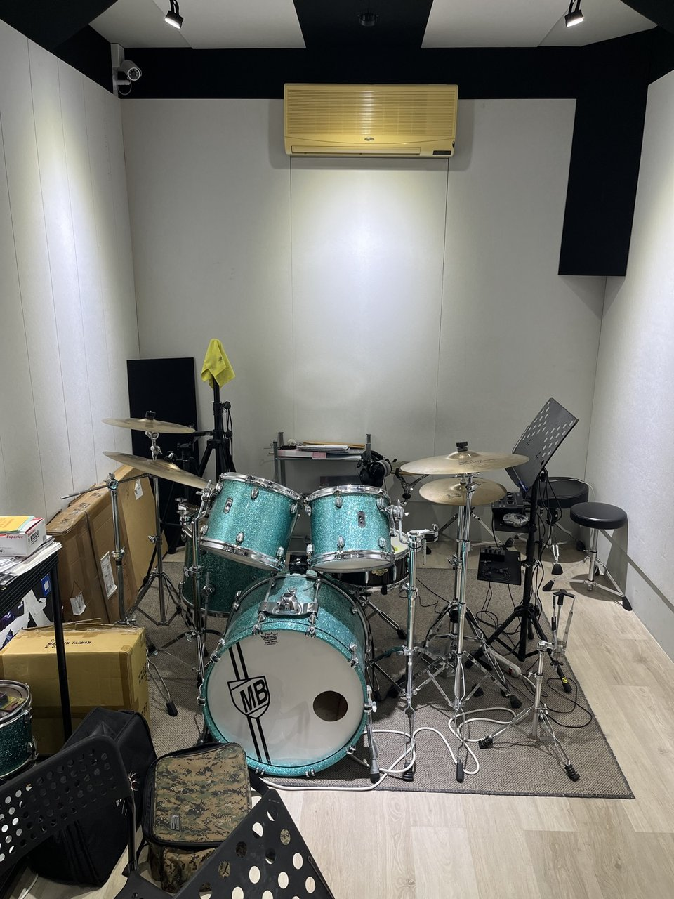
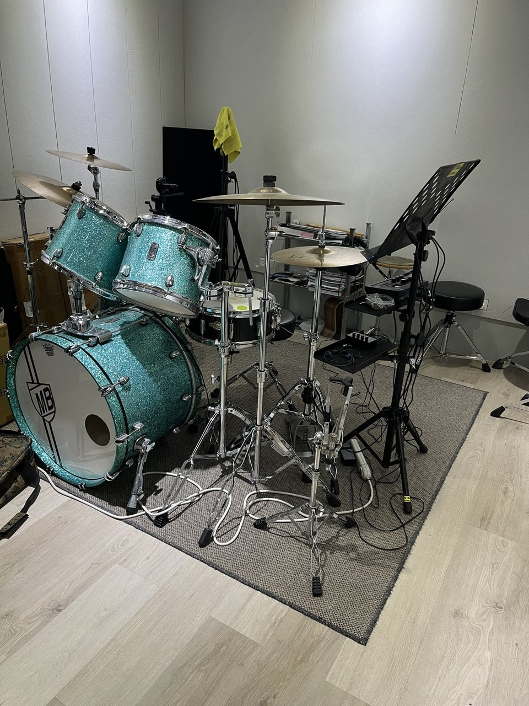
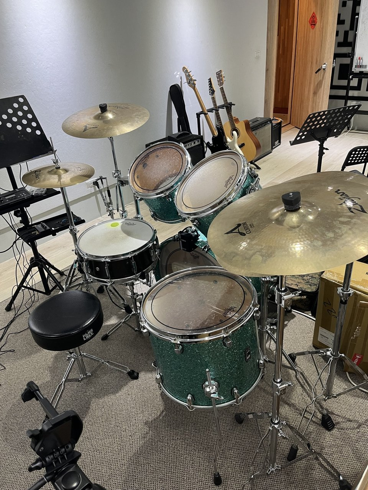
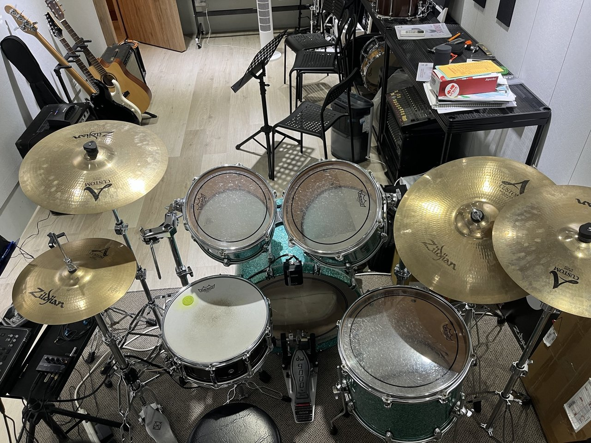

# 原聲爵士鼓組實拍建檔規格手冊

> **建檔日期**：2026-11-24  
> **資料來源**：10 張實拍多角度照片（正面、斜前、右側、鼓手俯視）  
> **結構化參數檔**：[`drumkit.json`](drumkit.json)  
> **3D 貼圖資源**：[`textures/teal-sparkle-tile.jpg`](textures/teal-sparkle-tile.jpg)（已打包至 [`drumkit-textures.js`](drumkit-textures.js) 供 `index.html` 零 CORS 載入）  
> **套用分頁**：`index.html` 中含鼓組之分頁（**V1 鼓教室** 與 **V2 練團室**）

---

## 1. 地毯與整體擺放基準

| 項目 | 規格 | 備註 |
| :--- | :--- | :--- |
| **地毯尺寸** | **240 cm（左右橫寬）× 180 cm（前後深度）** | 厚約 1.2 cm |
| **鼓組相對位置** | **置於地毯正中央** | 新空間鼓組後方空間充裕，採居中配置 |
| **地毯視覺呈現** | 素面深灰佔位（無實拍紋理） | 地毯將重新選購，僅先以精確尺寸建檔 |
| **鼓手面向** | 面向 `-X`（A2 入口牆），右手標準配置 | 左側為 `+Z`、右側為 `-Z` |

---

## 2. 鼓組五件規格（直徑 × 深度）

| 部位 | 尺寸（吋） | 換算（cm） | 深度狀態 | 外觀與鼓皮配置 | 固定／懸吊方式 |
| :--- | :---: | :---: | :---: | :--- | :--- |
| **大鼓 (Kick)** | **22" × 18"** | 55.9 × 45.7 | **已確認** | 湖水藍綠亮片漆＋同色木壓框；米白前鼓皮（左側雙黑斜線＋盾形 MB 圖樣、右下開音孔）；透明打擊面（內含消音枕）；單踏板 | 落地支腳（頂部預留座為空槽） |
| **小鼓 (Snare)** | **14" × 5.5"** | 35.6 × 14.0 | 暫採常見標準深度（待補實測） | **亮面純黑鼓肚**＋鍍鉻五金；白色噴砂打擊面（左上含吸音膠） | 獨立鍍鉻小鼓架 |
| **架鼓 1 (Tom 1)** | **12" × 9"** | 30.5 × 22.9 | 暫採常見標準深度（待補實測） | 湖水藍綠亮片漆＋淺原木內壁＋透明鼓皮 | 掛於左側獨立架（靠 Hi-Hat / 左 Crash 間） |
| **架鼓 2 (Tom 2)** | **13" × 10"** | 33.0 × 25.4 | 暫採常見標準深度（待補實測） | 湖水藍綠亮片漆＋淺原木內壁＋透明鼓皮 | 夾於右側 Ride 支架延伸臂 |
| **落地鼓 (Floor Tom)** | **16" × 16"** | 40.6 × 40.6 | 暫採常見標準深度（待補實測） | 湖水藍綠亮片漆＋淺原木內壁＋透明鼓皮 | 3 支鍍鉻落地支腳 |

---

## 3. 銅鈸配置（4 組亮面青銅鈸）

| 部位 | 尺寸（吋） | 換算直徑（cm） | 相對位置 | 支架配置 |
| :--- | :---: | :---: | :--- | :--- |
| **踩鈸 (Hi-Hat)** | **14"** | 35.6 | 鼓手左側 | 獨立鍍鉻踏板架 |
| **左前碎音鈸 (Left Crash)** | **18"** | 45.7 | 鼓手左前上方 | 獨立鍍鉻鈸架 |
| **疊音鈸 (Ride)** | **22"** | 55.9 | 鼓手右前上方（Tom 2 與 Floor Tom 間） | 鍍鉻鈸架（與 Tom 2 共用夾具） |
| **右側碎音鈸 (Right Crash)** | **16"** | 40.6 | 鼓手最右上方（Floor Tom 外側） | 獨立鍍鉻鈸架 |

---

## 4. 納入 3D 模型之周邊配件

- **圓面皮革鼓椅**：黑色皮革圓坐墊（直徑約 34 cm、高約 52 cm）搭配鍍鉻三腳雙支架。
- **黑色譜架＋雙層托盤**：位於鼓手左側（Hi-Hat 左側，仍在地毯 240 cm 橫寬範圍內），面向鼓手傾斜。
- **Yamaha EAD10**：
  - **拾音器（Sensor Unit）**：夾裝於大鼓打擊面鼓框正上方。
  - **主機（Main Module）**：擺放於左側黑色譜架之上層托盤。

---

## 5. 材質色號與實拍參考

- **湖水藍綠亮片漆（Teal Aqua Sparkle）**：基準校正色 `#359B94`（Three.js `roughness: 0.22`, `metalness: 0.45`），無縫亮片貼圖取樣自實拍色域分佈。
- **小鼓亮面純黑（Gloss Black）**：`#121417`（`roughness: 0.16`, `metalness: 0.25`）。
- **亮銀鍍鉻五金（Chrome）**：`#E2E8F0`（`roughness: 0.18`, `metalness: 0.92`）。
- **亮面青銅鈸（Brilliant Bronze）**：`#D8B96A`（`roughness: 0.20`, `metalness: 0.88`，程式化同心細密車紋）。

### 實拍角度紀錄

| 正面全景 | 左前 45° 特寫 |
| :---: | :---: |
|  |  |

| 右側俯視 | 鼓手視角俯視 |
| :---: | :---: |
|  |  |
