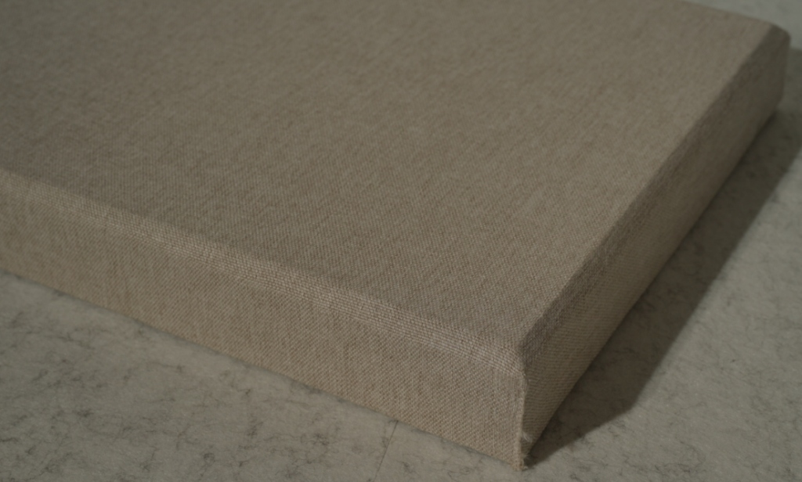
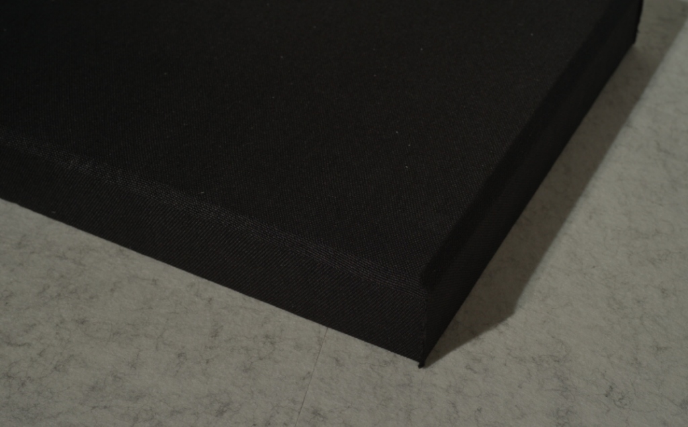
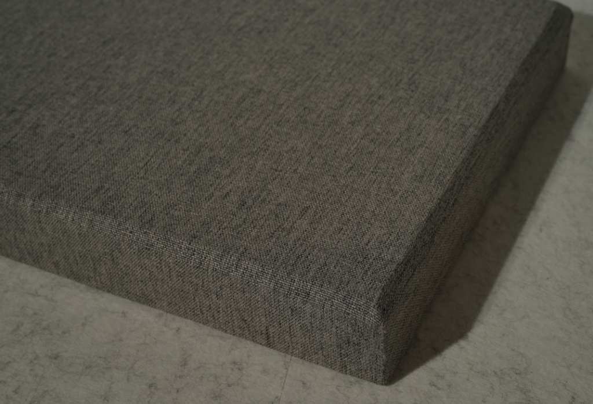
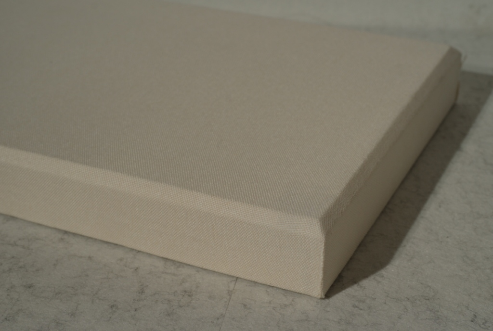

# 聲學吸音板布料實品建檔目錄

> **建檔日期**：2026-11-24  
> **資料來源**：4 張吸音板實品同光源實拍照片  
> **價格與編號**：四款布料**價格相同**（無廠商色號，統一以 `FB-01`～`FB-04` 作為本案編號）  
> **無縫貼圖檔**：`textures/fb01-tile.jpg` ～ `textures/fb04-tile.jpg`（已整合至 `index.html`「配色設計」分頁）  
> **結構化資料檔**：[`fabrics.json`](fabrics.json)（可供 `index.html` 3D 配色模型直接讀取使用）

---

## 1. 四款布料總覽與規格對照

> 註：4 張實拍照片均於同一偏暗暖光環境下拍攝（灰磚地面基準色約 `#716C5F`）。下表同時記錄**實拍原色（Raw）**與**自然光白平衡校正色（Calibrated，供 3D 與螢幕預覽對照）**。

| 編號 | 名稱 | 實拍原色 (Raw) | 校正參考色 (3D 預覽) | 織紋粗細與類型 | 紋理對比度 (Std) | 視覺與空間特性 |
| :--- | :--- | :---: | :---: | :--- | :---: | :--- |
| **FB-01** | **暖卡其燕麥亞麻** `Warm Oatmeal Linen` | `#726857` | `#B9B1A5` | 中粗平織亞麻紋 | 5.6（中） | 溫潤天然亞麻感、略帶雜紗顆粒，復古溫馨、耐髒 |
| **FB-02** | **霧面純黑細織布** `Matte Jet Black` | `#161513` | `#242322` | 細密緊緻平／斜織 | 3.7（低） | 極致霧面吸光、低反光、視覺收斂沉穩 |
| **FB-03** | **花紗暖炭灰亞麻** `Heathered Charcoal` | `#4E4A41` | `#83817C` | 粗獷雙色花紗亞麻 | 9.9（高） | 深淺灰交織立體感最強、最耐髒、專業錄音室感 |
| **FB-04** | **淺米白細平織布** `Light Cream Beige` | `#87806F` | `#CECAC1` | 細緻均勻平織紋 | 3.8（低） | 明度最高、布面均勻乾淨、最利於空間放大與照明反射 |

---

## 2. 單品實拍與細節紀錄

### FB-01：暖卡其燕麥亞麻（Warm Oatmeal Linen）

- **檔名**：`images/fabric-01-warm-oatmeal-linen.jpg`
- **色號基準**：實拍 `#726857` ／ 自然光校正 `#B9B1A5`
- **材質與織紋**：中粗平織亞麻，經緯紗線具自然微幅深淺變化，近看可見清晰布紋顆粒，倒角包邊線條俐落。
- **適用建議**：極度契合本案 Vintage 復古錄音室配色（莫蘭迪藍天花板 `#6E859B` ＋ 百合白牆 `#F3EEE1` ＋ 胡桃木地板 ＋ 復古紅門簾 `#73383A`），比 FB-04 更具手工溫潤感與耐髒性。

---

### FB-02：霧面純黑細織布（Matte Jet Black Fine Weave）

- **檔名**：`images/fabric-02-matte-jet-black.jpg`
- **色號基準**：實拍 `#161513` ／ 自然光校正 `#242322`
- **材質與織紋**：細密緊緻織紋，霧面吸光表現極佳，幾乎無表面反光，僅於倒角受光緣可見細緻紗線結構。
- **適用建議**：適合作為局部收斂色（如角落低頻陷阱或攝影吸光需求區）；因 6.42 坪空間照明依 EN 12464-1 需維持牆面反射率，不建議全室大面積使用。

---

### FB-03：花紗暖炭灰亞麻（Heathered Warm Charcoal Linen）

- **檔名**：`images/fabric-03-heathered-charcoal-grey.jpg`
- **色號基準**：實拍 `#4E4A41` ／ 自然光校正 `#83817C`
- **材質與織紋**：四款中織紋最粗獷且層次最豐富，雙色深淺灰花紗交織形成自然斑駁感，視覺存在感與耐髒度皆最高。
- **適用建議**：適合作為跳色或高接觸區域用布（如 A1 封門滿蓋至地吸音板、橫梁三面包覆或 45° 斜掛低頻板），與 FB-01 或 FB-04 雙色混搭層次極佳。

---

### FB-04：淺米白細平織布（Light Cream Beige Fine Plain Weave）

- **檔名**：`images/fabric-04-light-cream-beige.jpg`
- **色號基準**：實拍 `#87806F` ／ 自然光校正 `#CECAC1`
- **材質與織紋**：細緻均勻平織布面，無明顯花紗雜色，質感接近專業透聲平織布（如 Guilford 細平織系列），表面最乾淨柔和。
- **適用建議**：最接近本專案 `index.html` 配色設計預設色（`#D8CCB8`），最適合用於大面積牆面吸音板與天花板懸吊吸音雲，可與百合白牆面自然融合並維持最高室內照度。

---

## 3. 材質透聲性實務提醒

以上四款從實品倒角包覆與平織孔隙觀之，皆具織布包覆結構；正式下單前仍建議針對選定布款執行簡易**吹氣測試（Breathability Test）**，確認氣流可輕鬆穿透布面、無背膠或過密塗層，以確保 1 kHz 以上中高頻聲波能順利進入內部多孔吸音材而不致表面反射。
